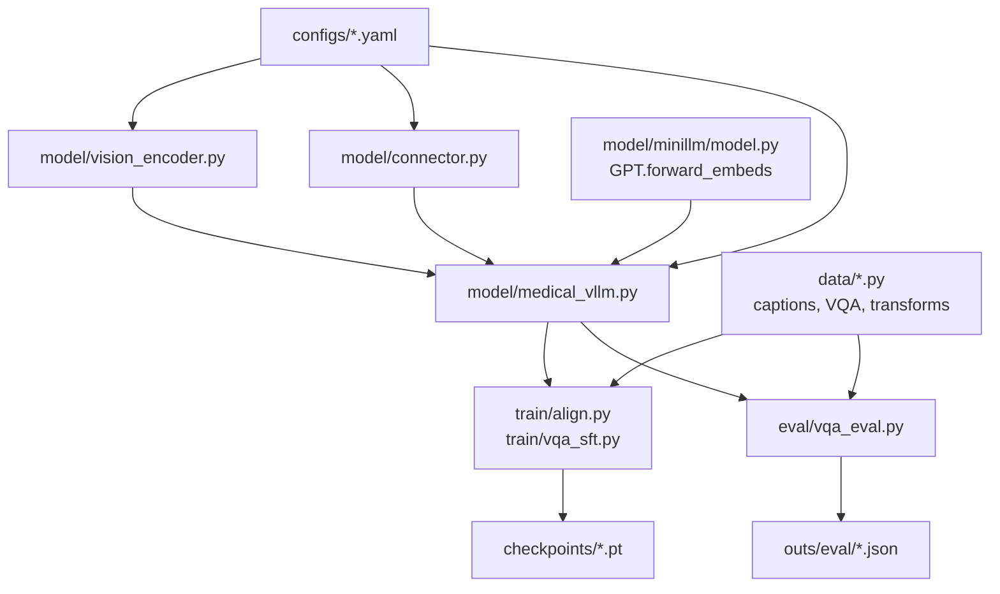
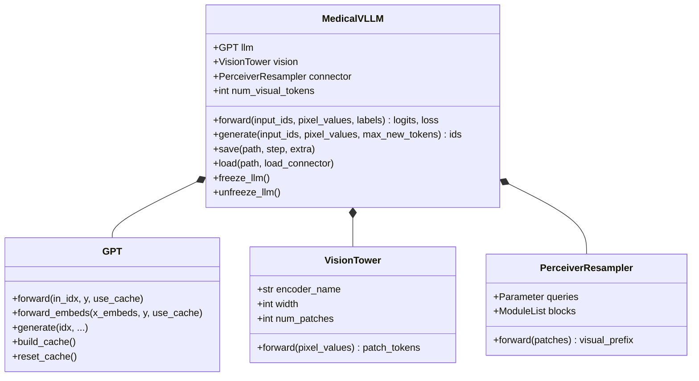
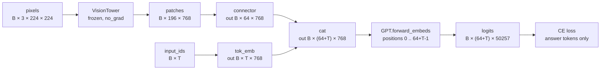

# How the model will be coded

Implementation plan for `medicalvllm`: what each file contains, the exact
interfaces, the one change to the vendored GPT, and the order everything gets
built and tested. Design rationale lives in [vllm.md](vllm.md) and
[connector.md](connector.md); this file is the coding contract.

---

## 1. Guiding principles

1. **Bottom-up, testable at every layer.** The connector and wrapper are
   tested with a fake random tower and a ~0.1M GPT on CPU — no HF downloads,
   no GPU needed. Per `agent.md`.
2. **Do not fork the GPT attention stack.** Reuse `minillm`'s `GPT`,
   `TransformerBlock`, KV cache and generation helpers. The only change is
   accepting pre-computed embeddings (`forward_embeds`).
3. **No new vocabulary, no `<image>` token.** The image is a soft prefix in
   embedding space. Old checkpoints, tokenizer and tied output head stay
   valid.
4. **The tower is a black box behind `VisionTower`.** open_clip vs HF
   differences are isolated in one file, so encoder ablations are a config
   change.
5. **Plain PyTorch + YAML + argparse**, matching `minillm`.
6. **One GPU first.** Add DDP/DataParallel only when Stage 2 throughput
   demands it; the code stays device-agnostic.

---

## 1.1 Reuse map — what comes from minillm, what is new

| minillm asset | Reuse? | How |
| --- | --- | --- |
| `model/model.py` (`GPT`) | **yes, copied** | one refactor: add `forward_embeds`, keep `forward` as a thin wrapper |
| `model/model_parts.py` | **yes, copied verbatim** | `TransformerBlock`, attention, FFN, LayerNorm, `LayerKVCache` |
| `configs/model.yaml` | **yes, copied** | 768-d, 1024 context, 9 layers, tied head |
| GPT-2 BPE tokenizer + EOT 50256 | **yes, helper copied** | tiktoken encoding from `pretrain/data.py`; no new vocab |
| SFT checkpoint loader | **yes, pattern copied** | read `state["model"]`, validate `state["model_config"]`, `load_state_dict(strict=True)` |
| `sft/tuning.py` training loop | **pattern ported** | atomic saves, hourly checkpoints, plots, detach/status/stop, HF sync |
| `pretrain/train.py` helpers | **pattern ported** | `--hours`, `--steps`, SIGTERM-safe final save |
| OpenWebText / Dolly data streams | **no** | replaced by ROCOv2 captions + medical VQA |
| MoE model, tool-calling SFT, DPO | **no** | out of scope; dense decoder only |
| `experiments/` benchmark scripts | **no** | new eval harness instead |

**Why copy instead of importing `minillm`?** Kaggle mounts each repo as its
own directory; `medicalvllm` must run standalone (`python -m train.align`
from its own root). Vendoring also freezes the decoder version, so changes in
`minillm` cannot silently break medical training. Record the source commit in
`model/minillm/SYNC.md`.

### Loading the SFT checkpoint

```python
state = torch.load(path, map_location="cpu", weights_only=True)
assert state["model_config"]["emb_dim"] == llm_cfg["emb_dim"]
self.llm.load_state_dict(state["model"], strict=True)
```

`state["model"]` has **unprefixed** keys (`tok_emb.weight`, `trf_blocks.0...`),
because minillm unwraps `DataParallel` before saving. We load it into
`self.llm` (the inner GPT), not into `MedicalVLLM`, so the keys match exactly.
The wrapper's own checkpoint later stores `llm.*`, `connector.*`, but Stage 1
initialization always reads the plain minillm format first.

### Exact `forward_embeds` refactor

Before (current minillm):

```python
def forward(self, in_idx, y=None, ignore_index=-100, use_cache=False):
    _, seq_len = in_idx.shape
    # cache checks, positions ...
    token_embedding = self.tok_emb(in_idx)
    x = token_embedding + self.pos_emb(positions)
    x = self.drop_emb(x)
    # blocks, final_norm, out_head, loss ...
```

After (vendored copy):

```python
def forward(self, in_idx, y=None, ignore_index=-100, use_cache=False):
    return self.forward_embeds(
        self.tok_emb(in_idx),
        y=y, ignore_index=ignore_index, use_cache=use_cache,
    )

def forward_embeds(self, x_embeds, y=None, ignore_index=-100,
                   use_cache=False):
    _, seq_len, _ = x_embeds.shape
    # SAME cache checks, positions ...
    x = x_embeds + self.pos_emb(positions)
    x = self.drop_emb(x)
    # SAME blocks, final_norm, out_head, loss ...
```

Nothing else changes: absolute positions, KV-cache offsets, loss masking,
weight tying and the output head are untouched. `forward()` remains
behavior-identical, which is what lets the old tiny tests and the SFT
checkpoint keep working.

---

## 2. Module dependencies



Build order follows the arrows: config → minillm GPT → vision → connector →
wrapper → data → trainers → eval.

---

## 3. Class design



---

## 4. File-by-file

### 4.1 `model/minillm/` — vendored decoder

Copy from `../minillm/model/` at a recorded commit (note it in `SYNC.md`):

- `model_parts.py` — unchanged (`LayerNorm`, `MultiHeadAttention`,
  `FeedForward`, `TransformerBlock`, `LayerKVCache`).
- `model.py` — one refactor, described below.
- `__init__.py` — export `GPT`.

**Why vendor instead of importing across repos:** Kaggle notebooks mount
each repo separately; `medicalvllm` must run standalone. The copy also lets
the embedding path evolve without breaking `minillm`.

### 4.2 `model/vision_encoder.py`

```python
class VisionTower(nn.Module):
    """Frozen image encoder -> patch tokens [B, P, 768]."""

    def __init__(self, cfg):
        self.backend = cfg["encoder_backend"]      # "open_clip" | "hf"
        self.image_size = cfg["image_size"]        # 224
        self.freeze = cfg.get("freeze_encoder", True)
        self._build(cfg["encoder"])
        if self.freeze:
            self.eval()
            for p in self.parameters():
                p.requires_grad_(False)

    def _build(self, name):
        """open_clip: create_model_and_transforms(..., pretrained=...)
        hf: CLIPModel.from_pretrained(name).vision_model"""

    @torch.no_grad()
    def forward(self, pixel_values):
        """pixel_values: [B, 3, S, S], already normalized.
        Returns patch tokens with CLS dropped: [B, P, 768]."""
```

Backend details to verify at P0, not assume:

- open_clip ViT: use the trunk's token output
  (`visual.trunk.forward_features(x)` or equivalent) and assert the shape is
  `[B, 197, 768]`; drop index 0.
- HF CLIP: `vision_model(pixel_values=...).last_hidden_state[:, 1:]`.
- The wrapper normalizes with **BiomedCLIP's** mean/std (OpenAI CLIP stats);
  grayscale images are replicated to 3 channels in `data/transforms.py`.

The tower is **never** saved in checkpoints; only its config name is, and it
is rebuilt at load time.

### 4.3 `model/connector.py`

```python
class PerceiverResampler(nn.Module):
    def __init__(self, dim=768, num_queries=64, depth=2, heads=12, ff_mult=4):
        ...
    def forward(self, patches):      # [B, 196, 768] -> [B, 64, 768]

class PooledMLPProjector(nn.Module):
    def forward(self, patches):      # [B, 196, 768] -> [B, 49, 768]

def build_connector(cfg):            # factory from configs/vision.yaml
```

Reference implementation is in [connector.md](connector.md) §8. Keep the
gate, the separate `ln_q`/`ln_kv`, and the 4× FFN.

### 4.4 `model/medical_vllm.py`

The wrapper owns the three parts and defines the public API.

```python
class MedicalVLLM(nn.Module):
    def __init__(self, llm_cfg, vision_cfg, connector_cfg):
        self.llm = GPT(llm_cfg)
        self.vision = VisionTower(vision_cfg)
        self.connector = build_connector(connector_cfg)
        self.num_visual_tokens = self.connector.num_queries

    def encode_image(self, pixel_values):
        with torch.no_grad():
            patches = self.vision(pixel_values)      # [B, P, 768]
        return self.connector(patches)               # [B, K, 768]

    def forward(self, input_ids, pixel_values=None, labels=None,
                use_cache=False):
        tok = self.llm.tok_emb(input_ids)            # [B, T, 768]
        if pixel_values is not None:
            vis = self.encode_image(pixel_values)    # [B, K, 768]
            tok = torch.cat([vis, tok], dim=1)       # [B, K+T, 768]
            if labels is not None:
                pad = labels.new_full((labels.size(0), vis.size(1)), -100)
                labels = torch.cat([pad, labels], dim=1)
        return self.llm.forward_embeds(
            tok, y=labels, use_cache=use_cache)
```

`generate` (no reuse of `GPT.generate`, because that method only takes ids):

```python
@torch.no_grad()
def generate(self, input_ids, pixel_values=None, max_new_tokens=128,
             temperature=0.0, top_k=None, eos_id=50256):
    self.eval()
    prefix_len = 0 if pixel_values is None else self.num_visual_tokens
    if prefix_len + input_ids.size(1) + max_new_tokens > self.llm.context_length:
        raise ValueError("image + prompt + generation exceeds context_length")

    tok = self.llm.tok_emb(input_ids)
    if pixel_values is not None:
        tok = torch.cat([self.encode_image(pixel_values), tok], dim=1)

    self.llm.reset_cache()
    logits = self.llm.forward_embeds(tok, use_cache=True)[:, -1]
    generated = input_ids
    for step in range(max_new_tokens):
        nxt = self.llm._sample_next(logits, temperature, top_k)
        generated = torch.cat([generated, nxt], dim=1)
        if (nxt == eos_id).all():
            break
        if step == max_new_tokens - 1:
            break
        # prefix is already in the cache from prefill; feed ids only
        logits = self.llm.forward_embeds(
            self.llm.tok_emb(nxt), use_cache=True)[:, -1]
    return generated
```

Rules encoded here:

- The visual prefix enters the KV cache **once**, during prefill. Later steps
  feed token embeddings only.
- No sliding-window fallback when an image is present: overflow is a hard
  error, never a silent drop of the image.
- EOS = 50256, same as minillm.

Freezing helpers:

```python
def freeze_llm(self):
    for p in self.llm.parameters(): p.requires_grad_(False)
    self.llm.eval()

def unfreeze_llm(self):
    for p in self.llm.parameters(): p.requires_grad_(True)
    self.llm.train()

def trainable_parameters(self):
    return [p for p in self.parameters() if p.requires_grad]
```

### 4.5 The one GPT change: `forward_embeds`

Current `GPT.forward` does lookup → positions → blocks → head. Split it:

```python
def forward(self, in_idx, y=None, ignore_index=-100, use_cache=False):
    return self.forward_embeds(
        self.tok_emb(in_idx),
        y=y, ignore_index=ignore_index, use_cache=use_cache,
    )

def forward_embeds(self, x_embeds, y=None, ignore_index=-100,
                   use_cache=False):
    _, seq_len, _ = x_embeds.shape
    # ... identical cache/position logic as the current forward ...
    x = x_embeds + self.pos_emb(positions)
    x = self.drop_emb(x)
    # ... identical blocks, final_norm, out_head, loss ...
```

This preserves `GPT.forward` byte-for-byte in behavior, so every existing
minillm tiny test passes on the vendored copy. No attention or cache changes.

---

## 5. Forward path with shapes



`forward` returns `(logits, loss)` exactly like minillm, so the training loop
shape matches the existing SFT trainer.

---

## 6. Checkpoint format

```python
{
    "format": "medicalvllm-v1",
    "step": step,
    "llm": self.llm.state_dict(),
    "connector": self.connector.state_dict(),
    "vision": {"encoder": name, "image_size": 224,
               "num_visual_tokens": 64},
    "config": {"llm": ..., "vision": ..., "connector": ...},
}
```

- The plain minillm SFT checkpoint loads into `llm` with `strict=True`
  (module names unchanged).
- Stage 1 saves a random-init connector; `load(..., load_connector=False)`
  allows starting Stage 1 from scratch.
- The 86M tower is never written to disk; it is rebuilt from its HF name.
- Atomic save: write to `*.tmp`, `os.replace`, same pattern as minillm.

---

## 7. Data layer

### 7.1 `data/transforms.py`

- PIL → RGB (replicate grayscale) → resize 224 → center crop → tensor.
- Normalize with BiomedCLIP/OpenAI CLIP mean/std.
- No flips in Stage 1; Stage 2 optional ±10° rotation only. Never horizontal
  flip laterality-sensitive radiographs.

### 7.2 `data/captions.py` — Stage 1

```python
class CaptionDataset(IterableDataset):
    def __iter__(self):
        for row in stream("eltorio/ROCOv2-radiology"):
            image = load_image(row)
            ids = tokenizer(caption)[: budget - 1] + [EOT]
            yield {"pixel_values": transform(image), "input_ids": ids}
```

Labels are the ids themselves; the wrapper prepends `-100` for the prefix.

### 7.3 `data/medical_vqa.py` — Stage 2

One adapter per source, all returning the same tuple:

```python
Example = namedtuple("Example", "image question answer meta")
```

- PMC-VQA: join CSV with image archive; choices rendered A/B/C/D; target
  `"A. <choice text>"`.
- SLAKE: JSON + images, English only.
- VQA-RAD: JSON + images.
- PathVQA: HF parquet; question/answer.
- Prompt template keeps the SFT checkpoint's familiar
  `Instruction:/Question:/Response:` shape.
- Triage at tokenization: full → truncated question → dropped; log counts.

### 7.4 Batching

- `collate` pads text right with EOT, labels `-100` on padding, stacks
  images.
- Text replay is a separate dataset; the batch sampler draws **whole batches**
  from one source at a time, so `pixel_values` is either always present or
  always `None`. No mixed image/no-image batches in v1.
- Dedup: md5 of image bytes; eval hashes blacklisted from train.

---

## 8. Trainers

### 8.1 `train/common.py` (ported from minillm)

- `set_seed`, `move_to_device`, `atomic_save`, `load_checkpoint`.
- `Trainer` base: step loop, grad clip, LR schedule, metrics JSON, plots,
  hourly save, `--hours`, `--steps`, `--detach`, `--status`, `--stop`,
  SIGTERM-safe final save, optional HF sync.
- No Lightning, no W&B dependency (CSV/JSON + matplotlib only).

### 8.2 `train/align.py` — Stage 1

```python
model = MedicalVLLM(...)
model.load_llm(ckpt)          # SFT checkpoint
model.freeze_llm()            # tower already frozen
opt = AdamW(model.connector.parameters(), lr=1e-4)
# ROCOv2 stream -> forward(pixels, ids, labels) -> CE
```

### 8.3 `train/vqa_sft.py` — Stage 2

```python
model = MedicalVLLM(...)
model.load(align_ckpt)        # connector weights from Stage 1
model.unfreeze_llm()
opt = AdamW([
    {"params": model.connector.parameters(), "lr": 5e-5},
    {"params": model.llm.parameters(),       "lr": 1e-5},
])
# weighted mix sampler; eval every N steps; save hourly
```

Optional LoRA is a later branch (`lora.enabled`), not in the first working
version. Full fine-tuning is the baseline.

### 8.4 `eval/vqa_eval.py`

- Greedy generation for reproducibility.
- Closed-form: exact match on yes/no (and letter for MCQ).
- Open: SQuAD-style token recall/F1.
- **Blind mode**: zero or shuffled visual prefix, reported in every table.
- Writes JSON + a markdown row for `experiment/results.md`.

---

## 9. Build and test order

Each step ends with runnable tests before the next starts.

| Step | Code | Test | Pass condition |
| --- | --- | --- | --- |
| **P0** | `scripts/check_assets.py` | manual | HF dataset fields and tower output shape verified; 10-sample stream works |
| **P1** | vendor GPT + `forward_embeds` | `test_gpt_embeds_tiny.py` | id-forward == embed-forward; KV parity; old tests still pass |
| **P2** | `model/connector.py` | `test_connector_tiny.py` | shapes, gate, gradients, frozen fake tower |
| **P3** | `model/medical_vllm.py` | `test_prefix_kv_tiny.py` | labels `-100` on prefix; cached == uncached; overflow raises |
| **P4** | `data/*` | `test_med_data_tiny.py` | triage, padding, dedup on synthetic rows |
| **P5** | `train/align.py` | `test_train_tiny.py` | 20 steps loss down; LLM/tower bit-identical |
| **P6** | `eval/` + `train/vqa_sft.py` | tiny eval | blind baseline + metrics on synthetic data |
| **P7** | real runs | — | Stage 1 4h, Stage 2 8h, ablations |

Tiny-model rules: `emb_dim=64`, `n_layers=2`, `context_length=128`,
`num_queries=8`, fake tower returns random `[B, 32, 64]`. CPU only, seconds
per test.

### Test files

```text
code_test/
├── test_gpt_embeds_tiny.py    # refactor parity + KV cache
├── test_connector_tiny.py     # shapes, gate, grads, frozen tower
├── test_prefix_kv_tiny.py     # wrapper labels + cached generation
├── test_med_data_tiny.py      # triage, collator, dedup
├── test_train_tiny.py         # 20-step loss, frozen weights
└── test_checkpoint_tiny.py    # roundtrip + minillm SFT key compat
```

---

## 10. What I will deliberately not do in v1

- **No new tokens / vocabulary resize.** Breaks weight tying and checkpoints.
- **No LoRA by default.** Baseline is full fine-tune of the 102.5M decoder.
- **No tower training.** Frozen in Stages 1–2; Stage 3 is a separate flag.
- **No sliding-window generation with images.** Hard error instead of
  silently dropping the prefix.
- **No mixed image/text batches.** Simpler and avoids `None` sentinels.
- **No custom attention rewrite.** Reuse minillm's blocks and cache.

---

## 11. First commits (in order)

1. `model: vendor minillm GPT + add forward_embeds` (tests green)
2. `model: frozen vision tower + patch-token wrapper`
3. `model: perceiver resampler + factory`
4. `model: MedicalVLLM forward/generate/checkpoint`
5. `data: transforms + ROCOv2 captions`
6. `data: medical VQA adapters + mix sampler`
7. `train: common trainer + Stage 1 alignment`
8. `eval: VQA metrics + blind baseline`
9. `train: Stage 2 VQA SFT`
10. `docs: results + runbook`

Every commit includes its tiny test and updates the relevant README section.
