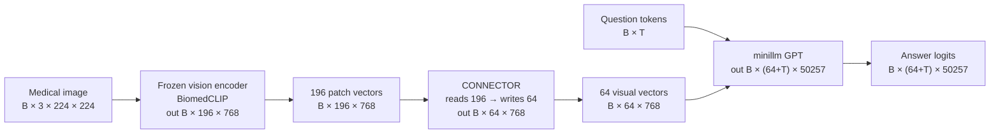
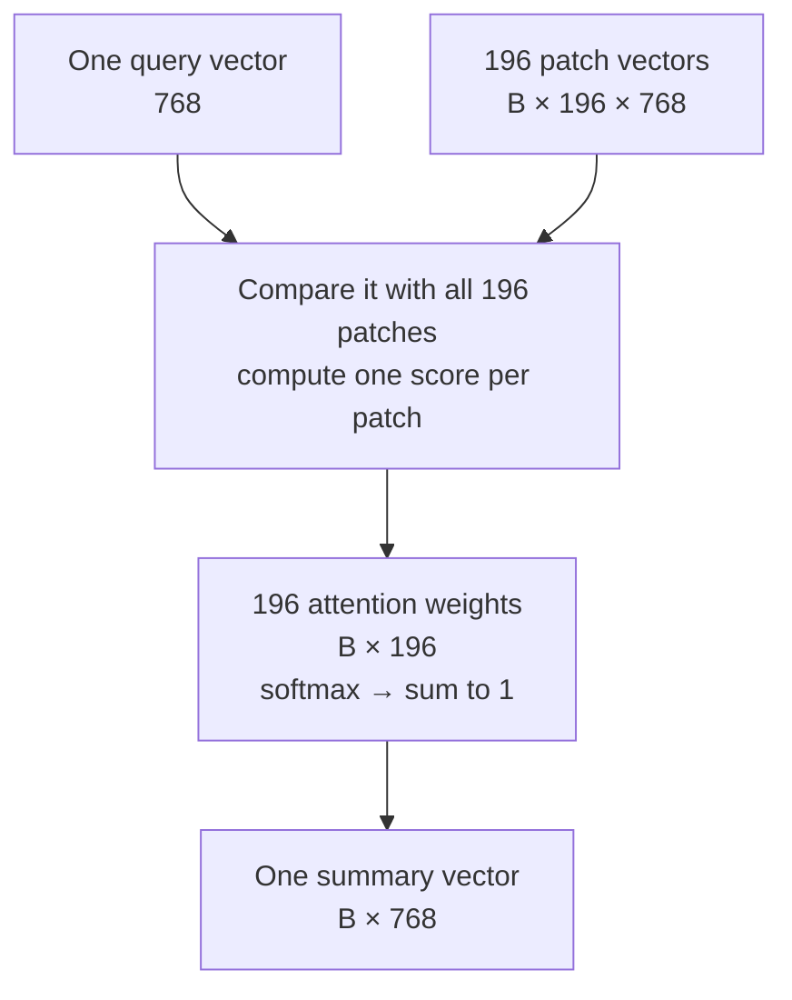
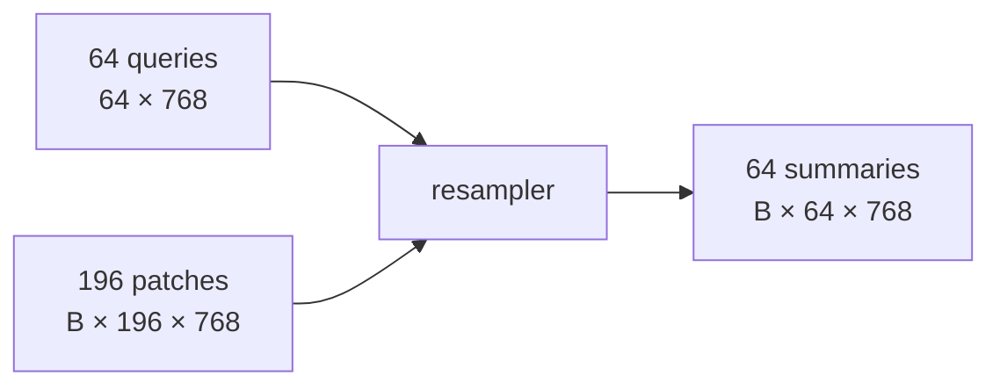
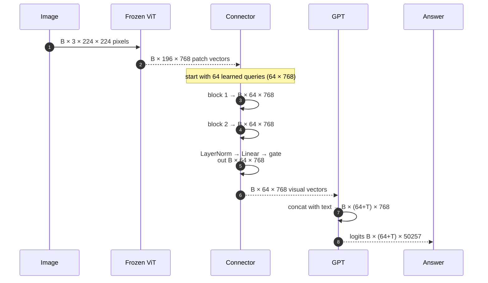
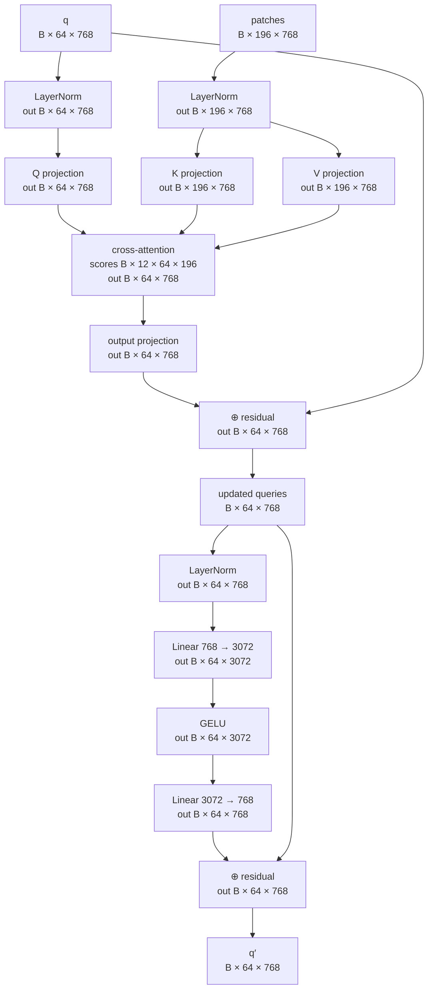
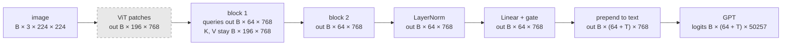
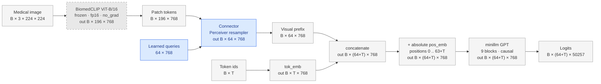
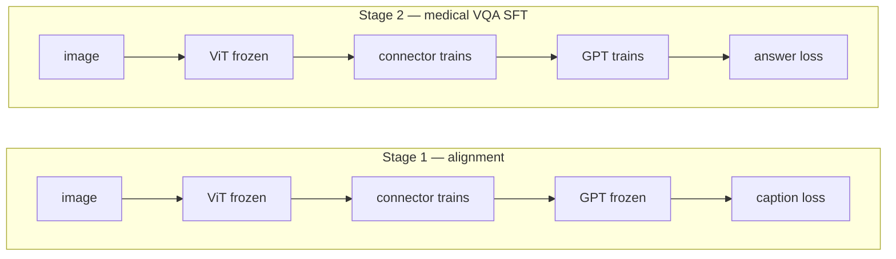
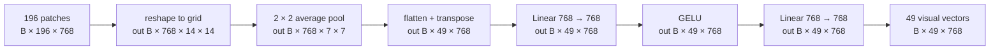
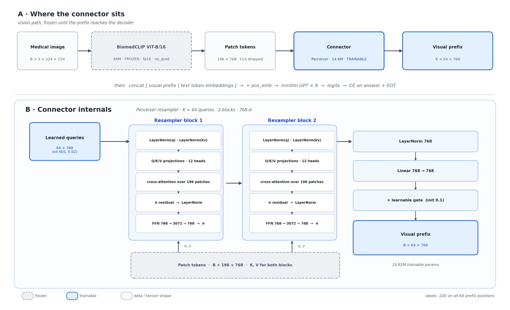

# Connector architecture — explained simply

The connector is the **translator between the image encoder and the language
model**. The image encoder produces 196 image vectors; the GPT cannot use them
directly. The connector reads all 196 and writes **64 new vectors** that the
GPT can read as if they were 64 extra words.

See [vllm.md](vllm.md) for the full project plan and
[references.md](references.md) for the papers this design comes from.

- **Input:** `patches [B, 196, 768]` — 196 patch tokens, CLS dropped
- **Output:** `visual_prefix [B, 64, 768]` — same width as minillm embeddings
- **Trainable params:** **14.82M** (2 resampler blocks, 4× FFN)
- **Trained in:** Stage 1 (LLM frozen) and Stage 2 (LLM unfrozen); tower always frozen

---

## 0. The whole idea in one picture



Think of it as a **compressor with a purpose**:

| Problem | Connector's answer |
| --- | --- |
| The encoder gives **196** vectors; the GPT was trained on sequences of word vectors | Output a fixed **64** vectors, short enough to fit the context |
| Image vectors and word vectors are both 768-d, but they do **not** live in the same learned space | Learn a projection that writes into the GPT's embedding space |
| We do not want to retrain the 86M image encoder | Keep the encoder frozen; only train the small connector |

---

## 1. What the 64 "queries" are

The connector owns **64 learned vectors**, called queries. They start as
random numbers and are trained. Each query behaves like a question asked of
the image. For example, one query might end up reacting to lung regions,
another to text labels, another to image borders — but nobody assigns these
roles; they are learned from data.



So one query produces **one summary vector**. With 64 queries, we get 64
summary vectors:



The comparison step is called **cross-attention**: the queries are the
"questions" (Q), the patches are the "answers to look at" (K and V). It is
called *cross* because Q comes from one source (queries) and K/V from another
(patches).

---

## 2. Step by step: one forward pass



In words:

1. The image becomes **196 patch vectors** of 768 numbers each.
2. Start with **64 blank query vectors** (the same 64 for every image; they
   are parameters, not something computed from the image).
3. **Block 1:** every query compares itself with all 196 patches, collects a
   weighted summary, then passes it through a small feed-forward network.
4. **Block 2:** repeat with the improved queries.
5. **LayerNorm + Linear + gate:** map the 64 vectors into the GPT's embedding
   space and scale them down so they do not drown the text at step 0.
6. The GPT receives `[64 visual vectors | question tokens]` and generates the
   answer.

---

## 3. Inside one block



Why each piece exists:

| Piece | Plain meaning |
| --- | --- |
| **LayerNorm before attention** | Keeps the numbers in a stable range so training does not explode |
| **Q / K / V projections** | Three learned linear maps that let queries and patches be compared and combined |
| **12-head cross-attention** | 12 independent comparisons at once; each head can notice a different relation |
| **Residual `+`** | Adds the old query back, so the new query only has to learn a *change* |
| **FFN 768 → 3072 → 768** | "Think about" what the query just collected; 4× wider is standard Transformer practice |
| **Second residual `+`** | Same stability trick |
| **No causal mask** | The whole image is visible at once; causality only matters for text generation |

The 64 queries do **not** attend to each other in this design. Each one
independently reads the patches. This is cheaper and simpler; duplication
between queries is possible but harmless at this scale.

---

## 4. Shapes at each step



| Symbol | Meaning | Value here |
| --- | --- | --- |
| `B` | batch size | 16–32 |
| `196` | number of image patches | 14 × 14 grid at 224 px, patch size 16 |
| `768` | hidden width everywhere | encoder width = GPT width |
| `64` | number of visual tokens (K) | fixed; ablated at 32 / 128 |
| `T` | number of text tokens | question + answer, ≤ 960 |

Sequence layout inside the GPT's 1024-position context:

```text
position:  0 ................ 63 | 64 ..................... 64+T-1
content:   [ 64 visual vectors ] | [ question ... answer ... EOT ]
labels:    [ -100, ignored     ] | [ -100 on prompt, loss on answer ]
```

The visual prefix is never supervised; cross-entropy ignores all 64 positions.

---

## 5. Where it sits in the full model



The connector does **not** change the vocabulary or add a special `<image>`
token. It only creates 64 vectors that occupy positions `0..63`. That is why
the old checkpoints, tokenizer and output head stay compatible.

---

## 6. Training: what learns when



| Stage | ViT | Connector | GPT | What it learns |
| --- | --- | --- | --- | --- |
| 1 | frozen | **train** | frozen | How to write image information in the GPT's own embedding language |
| 2 | frozen | **train** | **train** | How to answer medical questions using that visual information |
| 3 (optional) | top 2 blocks | train | train | Visual specialization at a very low LR |

Stage 1 is connector-only on purpose: if the GPT is also moving while the
connector is random, the GPT unlearns its SFT behavior. Freeze the translator's
target language first, then let both move.

---

## 7. Parameter count (K=64, depth=2, 4× FFN)

| Module | Shape | Params |
| --- | --- | ---: |
| Learned queries | `64 × 768` | 49,152 |
| Per block: `ln_q` + `ln_kv` | 2 × LayerNorm(768) | 3,072 |
| Per block: cross-attn `in_proj` | `768 × 2304` + bias | 1,771,776 |
| Per block: cross-attn `out_proj` | `768 × 768` + bias | 590,592 |
| Per block: `ln_ff` | LayerNorm(768) | 1,536 |
| Per block: FFN `768→3072→768` | 2 linears | 4,722,432 |
| **Per block subtotal** | | **7,089,408** |
| **2 blocks** | | **14,178,816** |
| Final `LayerNorm` | 768 | 1,536 |
| Output projection | `768 × 768` + bias | 590,592 |
| Output gate | scalar | 1 |
| **Total connector** | | **14,820,097 (~14.8M)** |

For scale: tower 86M (frozen), decoder 102.5M. In Stage 1 the connector is
the only trainable module (AdamW state ≈ 178MB); in Stage 2 it is ~7.7% of the
trainable stack.

---

## 8. Reference code

```python
class PerceiverResampler(nn.Module):
    """196 patch tokens -> K fixed visual tokens in decoder embedding space."""

    def __init__(self, dim=768, num_queries=64, depth=2, heads=12, ff_mult=4):
        super().__init__()
        self.queries = nn.Parameter(torch.randn(num_queries, dim) * 0.02)
        self.blocks = nn.ModuleList([
            nn.ModuleDict(dict(
                ln_q=nn.LayerNorm(dim),
                ln_kv=nn.LayerNorm(dim),
                attn=nn.MultiheadAttention(dim, heads, batch_first=True),
                ln_ff=nn.LayerNorm(dim),
                ff=nn.Sequential(
                    nn.Linear(dim, ff_mult * dim),
                    nn.GELU(),
                    nn.Linear(ff_mult * dim, dim),
                ),
            ))
            for _ in range(depth)
        ])
        self.ln_out = nn.LayerNorm(dim)
        self.proj = nn.Linear(dim, dim)
        self.gate = nn.Parameter(torch.tensor(0.1))

    def forward(self, patches):                       # [B, 196, 768]
        b = patches.size(0)
        q = self.queries.unsqueeze(0).expand(b, -1, -1)
        for blk in self.blocks:
            kv = blk["ln_kv"](patches)
            q = q + blk["attn"](blk["ln_q"](q), kv, kv,
                                need_weights=False)[0]
            q = q + blk["ff"](blk["ln_ff"](q))
        return self.gate * self.proj(self.ln_out(q))  # [B, 64, 768]
```

Why these details matter:

- **Query init N(0, 0.02):** matches GPT-2-style init; large queries saturate
  attention early.
- **Gate init 0.1:** at step 0 the visual prefix is small compared with trained
  token embeddings, so it cannot blow up the loss. The gate is learned, so
  Stage 1 can raise it if the signal is useful.
- **`need_weights=False`:** attention maps are not logged; skipping them saves
  memory.
- **Direct projection to 768:** no bottleneck needed; a 256-d intermediate only
  matters if memory is tight, which it is not here.

---

## 9. The simpler alternative (ablation baseline)



| | Perceiver (default) | Pooled MLP |
| --- | --- | --- |
| Visual tokens | 64, fixed | 49, tied to the 14×14 grid |
| Params | 14.82M | 1.18M |
| Selection | learned queries choose regions | uniform 2×2 pooling |
| Encoder swap | any patch count | needs a grid reshape |
| Role | main model | cheap sanity baseline |

Both write into 768-d space, so the GPT wrapper and data pipeline are
identical — switch with `connector: perceiver | pooled_mlp` in
`configs/vision.yaml`.

---

## 10. Common failure modes

| Failure | Symptom | Guard |
| --- | --- | --- |
| Prefix too loud at init | loss spike / NaN in first 100 steps | gate 0.1 + connector-only Stage 1 |
| Queries collapse to one vector | captions ignore details, low diversity | monitor pairwise cosine of queries |
| Patch features unnormalized | attention logits explode | `ln_kv` before every attention |
| Connector overfits ROCO caption style | generic "radiograph shows…" text | Stage 2 mix + 10% text replay |
| Tower accidentally trained | VRAM jump, degraded encoder | `requires_grad_(False)` + `eval()` + `no_grad()` + weight-equality test |
| Sequence overflow | image silently dropped | hard error when `64 + T + max_new > 1024` |

---

## 11. Tests specific to the connector

Per `agent.md`: tiny CPU model + fake random tower, no HF downloads.

1. output shape `[B, 64, 768]` for arbitrary `B`;
2. gate scales output linearly (`gate=0` ⇒ zero prefix);
3. gradients reach `queries`, `proj`, and block parameters;
4. frozen fake tower parameters are bit-identical after `backward()`;
5. `K` is configurable (32 / 64 / 128) and the output respects it;
6. full wrapper: the 64 prefix positions have `labels == -100`;
7. KV-cached generation with a prefix matches uncached logits (≤ 1e-4).

---

## 12. Visual version and prior art



*Editable source: [`make_connector_diagram.py`](make_connector_diagram.py) —
rerun `python experiment/make_connector_diagram.py` after design changes.*

This is the **Perceiver Resampler** from
[Flamingo](https://arxiv.org/abs/2204.14198), closely related to
[BLIP-2's Q-Former](https://arxiv.org/abs/2301.12597), and already used in the
medical VLM [Med-Flamingo](https://arxiv.org/abs/2307.15189). Full citations:
**[references.md](references.md)**.
