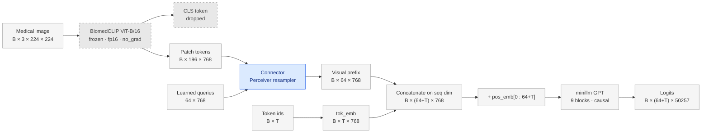
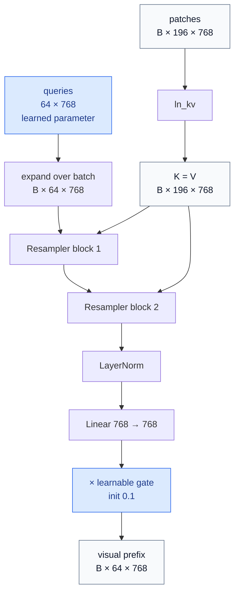
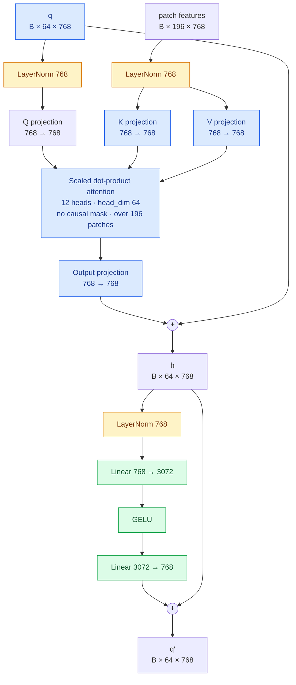
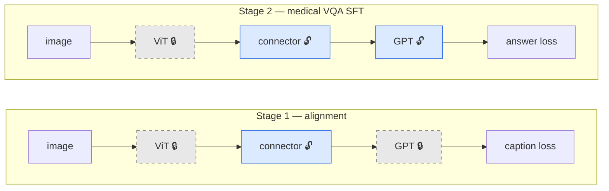
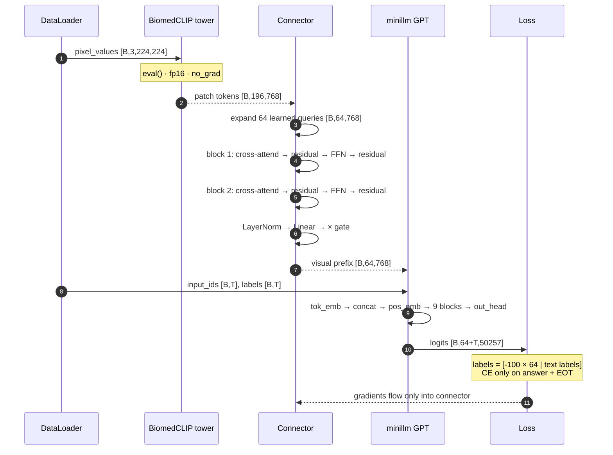
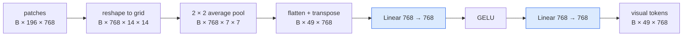

# Connector architecture — Perceiver resampler

Detailed design of the bridge between the frozen **BiomedCLIP ViT-B/16**
(196 patch tokens × 768-d) and the **minillm GPT** (768-d token embeddings).
See [vllm.md](vllm.md) for the full project plan.

- **Input:** `patches [B, 196, 768]` — patch tokens, CLS dropped
- **Output:** `visual_prefix [B, 64, 768]` — same width as minillm embeddings
- **Trainable params:** **14.82M** (2 resampler blocks, 4× FFN)
- **Trained in:** Stage 1 (LLM frozen) and Stage 2 (LLM unfrozen); tower always frozen


*Editable source: [`make_connector_diagram.py`](make_connector_diagram.py) —
rerun `python experiment/make_connector_diagram.py` after design changes.*

**Prior art:** this is the **Perceiver Resampler** from
[Flamingo (Alayrac et al., 2022)](https://arxiv.org/abs/2204.14198),
closely related to [BLIP-2's Q-Former](https://arxiv.org/abs/2301.12597).
The same connector is used in the medical VLM
[Med-Flamingo](https://arxiv.org/abs/2307.15189). Full citations, design-rule
paper (PaLM2-VAdapter) and medical precedents: **[references.md](references.md)**.

---

## 1. Where the connector sits



The connector never changes token ids or vocabulary — it only manufactures
`K = 64` vectors that occupy absolute positions `0..63`; text starts at
position 64.

---

## 2. Connector internals



Note: K/V are projected from the same patch sequence for both blocks in this
diagram; the reference implementation normalizes patches inside each block
(`ln_kv` per block). Functionally equivalent, ~1.5K params difference.

---

## 3. One resampler block (pre-norm residual)



Key properties:

1. **Queries are independent** — every one of the 64 slots cross-attends to
   the 196 patches; there is no self-attention among slots. Cheap, and
   duplication is harmless at this scale.
2. **No causal mask** — the image is fully visible; only the GPT is causal.
3. **Pre-norm residual** — stable at LR 1e-4 with no warmup tricks beyond
   the configured 200 steps.
4. **Cross-attention shapes** — `Q: [B, 64, 768]`, `K/V: [B, 196, 768]`,
   attention matrix `[B, 12, 64, 196]` (small: ~12K scores per image).

---

## 4. Exact tensor flow

```mermaid
flowchart LR
    A["pixel_values<br/>B × 3 × 224 × 224"] --> B["ViT patch embed<br/>14 × 14 grid"]
    B --> C["12 transformer blocks<br/>frozen"]
    C --> D["final LayerNorm<br/>B × 197 × 768"]
    D --> E["drop CLS<br/>B × 196 × 768"]
    E --> F["resampler ×2<br/>B × 64 × 768"]
    F --> G["gate × proj<br/>B × 64 × 768"]
    G --> H["concat with tok_emb<br/>B × (64+T) × 768"]
    H --> I["+ pos_emb<br/>positions 0..63+T"]
    I --> J["GPT blocks 0..8<br/>causal"]
    J --> K["final_norm + out_head<br/>B × (64+T) × 50257"]
    K --> L["CE on answer tokens<br/>labels -100 elsewhere"]

    style C fill:#e8e8e8,stroke:#888,stroke-dasharray:5 5
    style F fill:#dbeafe,stroke:#2563eb
    style G fill:#dbeafe,stroke:#2563eb
```



Sequence budget with `context_length = 1024`:

| Segment | Positions | Count |
| --- | --- | --- |
| Visual prefix | `0 … 63` | 64 |
| Prompt / question | `64 … 64+T-1` | up to ~800 |
| Answer + EOT | after prompt | ~100–150 |
| **Hard limit** | `0 … 1023` | 1024 |

If `64 + T + max_new_tokens > 1024`, image generation raises instead of
silently sliding the window (which would drop the image).

---

## 5. Training / gradient flow



| Stage | Tower | Connector | GPT | Purpose |
| --- | --- | --- | --- | --- |
| 1 | frozen | **train** | frozen | Learn to speak the decoder's embedding space |
| 2 | frozen | **train** | **train** | Learn medical QA behavior on top of aligned prefix |
| 3 (opt) | top 2 blocks | train | train | Visual specialization at LR 1e-6 |

The tower forward runs under `torch.no_grad()` in **all** stages, so it adds
no activation memory for backward and no optimizer state.

---

## 6. Forward pass (sequence)



---

## 7. Parameter count (K=64, depth=2, 4× FFN)

| Module | Shape | Params |
| --- | --- | ---: |
| Learned queries | `64 × 768` | 49,152 |
| Per block: `ln_q` + `ln_kv` | 2 × LayerNorm(768) | 3,072 |
| Per block: cross-attn `in_proj` | `768 × 2304` + bias | 1,771,776 |
| Per block: cross-attn `out_proj` | `768 × 768` + bias | 590,592 |
| Per block: `ln_ff` | LayerNorm(768) | 1,536 |
| Per block: FFN `768→3072→768` | 2 linears | 4,722,432 |
| **Per block subtotal** | | **7,089,408** |
| **2 blocks** | | **14,178,816** |
| Final `LayerNorm` | 768 | 1,536 |
| Output projection | `768 × 768` + bias | 590,592 |
| Output gate | scalar | 1 |
| **Total connector** | | **14,820,097 (~14.8M)** |

For comparison, the frozen tower is 86M and the decoder is 102.5M, so the
connector is ~7.7% of the trainable stack in Stage 2 and the only trainable
module in Stage 1 (AdamW state ≈ 178MB fp32).

---

## 8. Reference implementation

```python
class PerceiverResampler(nn.Module):
    """196 patch tokens -> K fixed visual tokens in decoder embedding space."""

    def __init__(self, dim=768, num_queries=64, depth=2, heads=12, ff_mult=4):
        super().__init__()
        self.queries = nn.Parameter(torch.randn(num_queries, dim) * 0.02)
        self.blocks = nn.ModuleList([
            nn.ModuleDict(dict(
                ln_q=nn.LayerNorm(dim),
                ln_kv=nn.LayerNorm(dim),
                attn=nn.MultiheadAttention(dim, heads, batch_first=True),
                ln_ff=nn.LayerNorm(dim),
                ff=nn.Sequential(
                    nn.Linear(dim, ff_mult * dim),
                    nn.GELU(),
                    nn.Linear(ff_mult * dim, dim),
                ),
            ))
            for _ in range(depth)
        ])
        self.ln_out = nn.LayerNorm(dim)
        self.proj = nn.Linear(dim, dim)
        self.gate = nn.Parameter(torch.tensor(0.1))

    def forward(self, patches):                       # [B, 196, 768]
        b = patches.size(0)
        q = self.queries.unsqueeze(0).expand(b, -1, -1)
        for blk in self.blocks:
            kv = blk["ln_kv"](patches)
            q = q + blk["attn"](blk["ln_q"](q), kv, kv,
                                need_weights=False)[0]
            q = q + blk["ff"](blk["ln_ff"](q))
        return self.gate * self.proj(self.ln_out(q))  # [B, 64, 768]
```

Design details worth preserving:

- **Query init** `N(0, 0.02)` matches GPT-2-style init; large queries cause
  early attention saturation.
- **Gate init 0.1** keeps the prefix small relative to trained token
  embeddings at step 0. The gate is a *learned scalar*, so Stage 1 can raise
  it if the signal is useful.
- **`need_weights=False`** avoids materializing the 12K-score matrix for
  logging (attention weights are not used).
- **Projection into 768-d is direct** — no bottleneck. A 256-d intermediate
  is only worth it if connector memory ever matters, which it does not here.
- **No dropout inside the connector** by default; Stage 2 GPT dropout (0.1)
  already regularizes, and the connector sees each image once per epoch.

---

## 9. Alternative connector (ablation baseline)



| | Perceiver (default) | Pooled MLP |
| --- | --- | --- |
| Visual tokens | 64, fixed | 49, tied to 14×14 grid |
| Params | 14.82M | 1.18M |
| Selection | learned queries choose regions | uniform 2×2 pooling |
| Encoder swap | any patch count | needs grid reshape |
| Role | main model | cheap baseline / sanity check |

Both write into the same 768-d space, so the GPT wrapper and data pipeline
are identical — switch with `connector: perceiver | pooled_mlp` in
`configs/vision.yaml`.

---

## 10. Failure modes and guards

| Failure | Symptom | Guard |
| --- | --- | --- |
| Prefix too loud at init | loss spikes / NaN in first 100 steps | gate 0.1 + connector-only Stage 1 |
| Queries collapse to one vector | captions ignore details, low diversity | monitor pairwise cosine of queries; add diversity loss only if observed |
| Patch features unnormalized | attention logits explode | `ln_kv` before every attention |
| Connector overfits ROCO style | generic "radiograph shows…" captions | Stage 2 mix + 10% text replay; early stop on VQA dev |
| Tower accidentally trained | VRAM jump, degraded encoder | `requires_grad_(False)` + `eval()` + `no_grad()` + test asserting bit-identical tower weights after a step |
| Sequence overflow | image silently dropped | hard error when `K + T + max_new > context_length` |

---

## 11. Tests specific to the connector

Per `agent.md`, tiny CPU model + fake random tower, no HF downloads:

1. output shape `[B, 64, 768]` for arbitrary `B`;
2. gate scales output linearly (`gate=0` ⇒ zero prefix);
3. gradients reach `queries`, `proj`, block params;
4. frozen fake tower params are bit-identical after `backward()`;
5. `K` is configurable (32 / 64 / 128) and output respects it;
6. full wrapper: prefix positions have `labels == -100`;
7. KV-cached generation with prefix matches uncached logits (≤ 1e-4).
