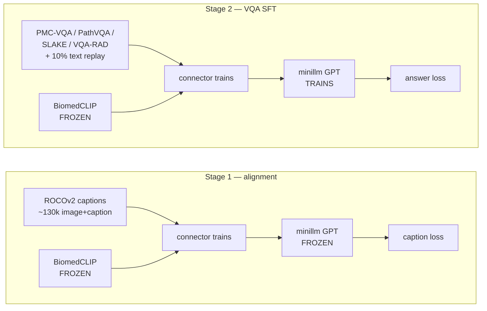
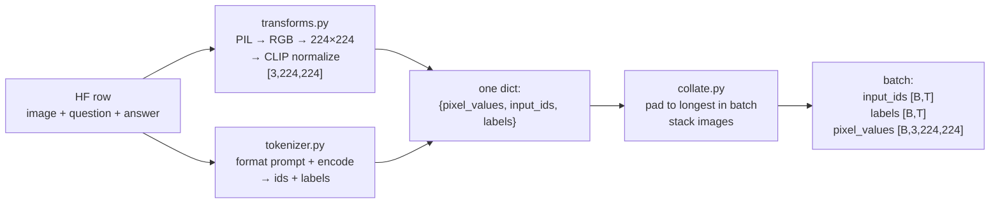
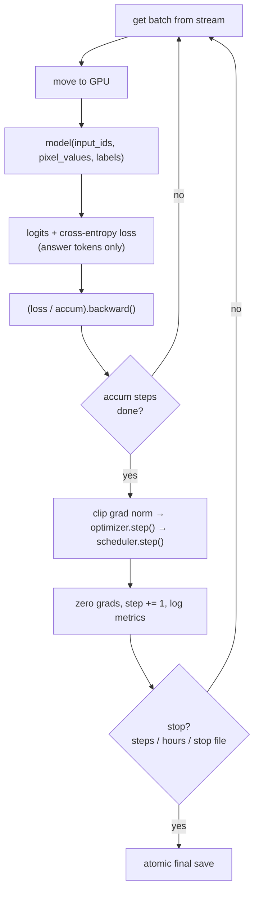

# How data and training work

A concrete walkthrough of what happens to one example, from a HuggingFace row
to a gradient. Read [connector.md](connector.md) §0–2 first for the model picture.

---

## 1. The big picture

There are **two stages**. What changes between them is the data and *which
weights are allowed to move*:



| | Stage 1 | Stage 2 |
|---|---|---|
| Data | ROCOv2 radiology captions | 4 medical VQA datasets + Dolly replay |
| Connector | trains | trains |
| GPT | frozen | trains |
| Vision tower | frozen | frozen |
| LR | 1e-4 (connector only) | 5e-5 connector / 1e-5 GPT |
| Goal | learn to *write* image info in GPT's embedding language | learn to *answer* using that info |

Why this order: if the GPT moved while the connector was still random, the GPT
would unlearn its SFT behavior trying to interpret noise. Freeze the target
language first, then let both move.

---

## 2. One example through the data pipeline



### 2.1 Image side — `data/transforms.py`

- Convert to RGB (CMYK/grayscale get replicated to 3 channels).
- Resize + center crop to 224×224.
- Normalize with **CLIP's** mean/std, because the encoder is BiomedCLIP.
- **No horizontal flip** — left/right matters in radiology.

### 2.2 Text side — `data/tokenizer.py`

We reuse minillm's exact SFT prompt format, so the checkpoint's
instruction-following behavior transfers:

```text
Instruction:
Answer the following medical question about the image with a short, direct answer.

Question:
<question>

Response:
<answer><|endoftext|>
```

Tokenized with GPT-2 BPE (`tiktoken`), vocab 50257, EOT = 50256.

**The label trick** — this is the most important idea in the data layer:

```python
ids    = prompt_ids + answer_ids + [EOT]
labels = [-100]*len(prompt_ids) + answer_ids + [EOT]
```

`-100` is PyTorch's "ignore this position" value for cross-entropy. So the
loss is computed **only on the answer**, not on the question. Then the wrapper
prepends 16 more `-100`s for the visual prefix:

```text
GPT positions:  0 .. 15      16 .. 16+T-1
content:    [16 visual vecs] [ question ... answer EOT ]
labels:     [-100 × 16]      [-100 on prompt | loss on answer]
```

**Triage** (mirrors minillm SFT): if the full prompt+answer doesn't fit the
112-token text budget, drop the `Context:` block; if it still doesn't fit,
keep only `Question:` + answer; if still too long, drop the example. Counts
are logged in each stream's `.stats`.

### 2.3 Stage 1 dataset — `data/captions.py`

`CaptionStream` streams `eltorio/ROCOv2-radiology` (fields: `image`,
`caption`, `image_id`, `cui`). For each row it builds:

```text
Instruction:
Describe the medical image in one sentence.

Response:
<caption><|endoftext|>
```

Streaming means no full download; a shuffle buffer of 500 randomizes order.

### 2.4 Stage 2 datasets — `data/medical_vqa.py`

| Source | HF id | Fields used |
|---|---|---|
| PMC-VQA | `mdwiratathya/PMC-VQA_small` | `image`, `caption`, `question`, `answer` |
| PathVQA | `flaviagiammarino/path-vqa` | `image`, `question`, `answer` |
| SLAKE | `mdwiratathya/SLAKE-vqa-english` | `image`, `question`, `answer` |
| VQA-RAD | `flaviagiammarino/vqa-rad` | `image`, `question`, `answer` |
| Text replay | `databricks/databricks-dolly-15k` | `instruction`, `context`, `response` |

Each source goes through `VQAStream`, which normalizes all the different field
names into the same dict. PMC-VQA's `caption` becomes the `Context:` block;
MCQ choices are a fallback if the answer field is empty.

**Text replay** is Dolly with `pixel_values = None`. It keeps the GPT from
forgetting how to answer text-only questions during Stage 2.

### 2.5 Mixing sources — `BatchMixSampler`

The config sets weights:

```yaml
mix: {pmc_vqa: 0.55, path_vqa: 0.20, slake: 0.10, vqa_rad: 0.05, text_replay: 0.10}
```

`BatchMixSampler` picks a source by those weights, then draws a **whole batch**
from it. This matters: a batch is never a mix of image and text-only examples,
so `pixel_values` is either a real tensor for the whole batch or `None` for the
whole batch (`collate_fn` raises if you mix them). Streams restart at epoch end.

---

## 3. The training loop

Both Stage 1 (`train/align.py`) and Stage 2 (`train/vqa_sft.py`) share this
shape. The loop is plain PyTorch — no Lightning, no W&B.



Key details:

- **Gradient accumulation**: `batch_size × grad_accum_steps` micro-batches make
  one optimizer step. Stage 1: 16×2=32 effective. Stage 2: 8×2=16.
- **Optimizer**: AdamW, weight decay 0.01, linear warmup then cosine decay.
- **Grad clipping**: norm 1.0.
- **Stop conditions**: `--steps`, `--hours`, a `.stop_align` / `.stop_vqa` file,
  SIGTERM, or Ctrl-C. All paths reach the `finally` block and save.
- **Periodic saves**: every 60 min by default, plus a final save. Writes to
  `*.tmp` then `os.replace` (atomic — no half-written checkpoints).
- **Metrics**: appended to `metrics.jsonl` and mirrored in `metrics.json`, with
  loss / LR / grad norm every 10 steps.

### What actually trains

Stage 1 (`align.py`):

```python
model.load(sft_ckpt, load_connector=False)   # GPT from normal SFT, connector fresh
model.freeze_llm()                            # GPT.requires_grad_(False)
model.vision.set_frozen(True)                 # tower eval + no_grad
opt = AdamW(model.connector.parameters(), lr=1e-4)
```

Stage 2 (`vqa_sft.py`):

```python
model.load(align_ckpt, load_connector=True)   # reuse trained connector
model.unfreeze_llm()
opt = AdamW([
    {"params": connector.parameters(), "lr": 5e-5},
    {"params": llm.parameters(),       "lr": 1e-5},
])
```

Two param groups because the connector should adapt faster than the GPT.

### Where the loss comes from

Inside `MedicalVLLM.forward`:

```python
tok = self.llm.tok_emb(input_ids)            # [B,T,768]
vis = self.encode_image(pixel_values)        # [B,16,768] (tower no_grad)
tok = torch.cat([vis, tok], dim=1)           # [B,16+T,768]
labels = torch.cat([-100 × 16, labels], 1)   # prefix unsupervised
return self.llm.forward_embeds(tok, y=labels)
```

`forward_embeds` runs the GPT and computes cross-entropy over the answer
positions. The image contributes only as 16 extra input vectors.

---

## 4. Checkpoint contents

```python
{
  "format": "medicalvllm-v2",
  "phase": 1 or 2,
  "step": ...,                    # GLOBAL across phases
  "epoch": ...,                   # examples_seen / epoch_size
  "examples_seen": ...,
  "total_text_tokens": ...,       # supervised (answer) tokens seen
  "total_images_seen": ...,
  "resumed_from": "...",
  "llm": GPT state_dict,          # unprefixed keys → loads into inner GPT
  "connector": connector state_dict,
  "optimizer": {...},             # keyed by param NAME, not tensor object
  "scheduler": {...},
  "vision": {"encoder": name, ...},  # name ONLY — 86M tower never saved
  "config": {"llm": ..., "vision": ..., "connector": ...},
  "stream_stats": {...},
}
```

Optimizer state is keyed by **parameter name** so it can be reloaded into a
fresh model instance, and so Phase 1's connector-only optimizer can hand its
state to Phase 2's connector+LLM optimizer (LLM params start fresh). The tower
is rebuilt from its HF name at load time. Checkpoints are ~590 MB (GPT +
optimizer) rather than ~800 MB (no tower).

### Flags and HF sync

- no flag → local resume only, no HF read/write
- `--hf` → resume from and upload to `medical_vllm/phaseN/` in the HF repo;
  uploads `phase_N_latest.pt`, `checkpoints/phase_N_step*.pt`, and `outs/` with
  `metrics.json` + `loss_vs_step.png` + `lr_vs_step.png`
- `--no-hf` → explicitly disable HF even if config enables it
- `--new` → random LLM weights, ignore all checkpoints, global step 0

`step` is global: if Phase 1 ended at 10,000 then Phase 2 starts at 10,000 with
the same token/image counters. Nothing is uploaded without `--hf`.

---

## 5. Run it

```bash
python -m code_test.test_all        # verify data + model without long training
python -m train.align --steps 2     # see Stage 1 on real ROCOv2 data
python -m train.vqa_sft --steps 2   # see Stage 2 on the real VQA mix
```

Watch these to confirm it's working:

- `outs/align/metrics.json` — loss should trend down over steps
- `stats={'seen': ..., 'kept': ..., 'dropped': ...}` printed at the end — shows
  triage working
- `LLM weights unchanged` / `tower weights unchanged` in the test output —
  confirms freezing

Full commands and troubleshooting: [runbook/README.md](../runbook/README.md).
