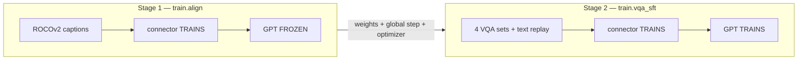
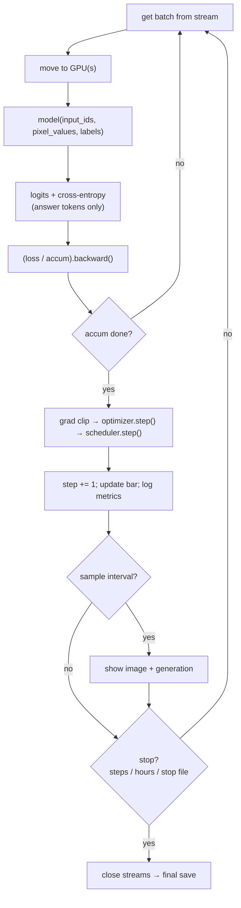

# `train/` — training code

This folder contains the two training stages and all the shared plumbing.

| File | Role |
| --- | --- |
| `align.py` | **Stage 1** — connector-only alignment on ROCOv2 captions |
| `vqa_sft.py` | **Stage 2** — connector + LLM medical VQA SFT |
| `common.py` | config, seeding, devices, optimizer/scheduler helpers, `RunState`, checkpoint build/restore, tqdm bar, live samples, metrics, plots, streaming-shutdown fix |
| `hf_sync.py` | HuggingFace download/upload — **only active with `--hf`** |
| `__init__.py` | package marker |

Both trainers are plain PyTorch + YAML. No Lightning, no W&B.

```bash
python -m train.align --steps 200
python -m train.vqa_sft --steps 100
```

---

## 1. What each stage does



The vision tower is frozen in both. Freeze the GPT first while the connector is
random, then unfreeze it — otherwise the GPT unlearns its SFT behaviour trying
to interpret noise.

---

## 2. CLI flags

Both trainers share the same flags.

| Flag | Default | What it does |
| --- | --- | --- |
| `--config PATH` | `configs/align.yaml` / `configs/vqa_sft.yaml` | YAML config file. All paths inside are resolved relative to the repo root. |
| `--steps N` | config `steps` | Stop after N **global** optimizer steps. Overrides config. |
| `--hours H` | config `hours` | Stop after H wall-clock hours. Whichever limit (`steps`/`hours`) hits first wins. |
| `--device auto\|cpu\|cuda:0` | `auto` | `auto` picks CUDA if present. `cuda:0` forces one GPU. |
| `--num-gpus N` | config `num_gpus` (2) | Max GPUs for `nn.DataParallel`. With 2 visible GPUs the model is replicated across both. |
| `--seed N` | 0 | Seeds Python, NumPy and CUDA. |
| `--stop PATH` | `.stop_align` / `.stop_vqa` | Stop cleanly by `touch`-ing this file. SIGTERM/Ctrl-C also stop cleanly. |
| `--detach` | off | Relaunch detached in the background; prints the log path. |
| `--hf` | off | **Enable HF**: download the phase's `*_latest.pt` if present, and upload checkpoints + `outs/` after every save. |
| `--no-hf` | off | Explicitly disable HF even if config says `enabled: true`. |
| `--new` | off | Random LLM weights, ignore every checkpoint, start at **global step 0**. |

### Important flag interactions

- **Nothing is uploaded unless `--hf` is passed.** No flag and `--no-hf` both
  mean "local files only". The CLI always overrides `hf.enabled` in the YAML.
- `--new` wins over everything: no HF download, no local checkpoint, no SFT
  weights. The connector is also freshly initialised.
- If both `--steps` and `--hours` are given, the progress bar follows **steps**.

---

## 3. Config parameters — Stage 1 (`configs/align.yaml`)

| Key | Default | Meaning |
| --- | --- | --- |
| `llm_checkpoint` | `../minillm/sft_checkpoints/sft_model.pt` | Local **normal SFT** checkpoint (not tool-calling). Tried first. |
| `hf_fallback.repo` / `filename` | `sddfhy546y/minillm` / `sft_model.pt` | If the local file is missing, download the SFT weights from here. |
| `data.dataset` | `eltorio/ROCOv2-radiology` | Streamed HF dataset. Fields used: `image`, `caption`. |
| `data.radiology_only` | `true` | Reserved filter flag (ROCOv2 is radiology-only). |
| `data.shuffle_buffer` | 500 | Streaming shuffle buffer size. `0`/`1` disables shuffling. |
| `data.max_text_tokens` | 112 | Text budget = context 128 − K 16. Longer captions are triaged/truncated. |
| `data.max_image_size` | 512 | Safety cap before resizing to 224. |
| `data.epoch_size` | 130000 | Approximate rows per pass — used only to report `epoch` = examples_seen / epoch_size. |
| `freeze_llm` | `true` | Stage 1 always freezes the GPT. |
| `num_gpus` | 2 | DataParallel device count. |
| `batch_size` | 16 | Micro-batch size. |
| `grad_accum_steps` | 2 | Effective batch = 16 × 2 = **32** examples per optimizer step. |
| `learning_rate` | 1e-4 | AdamW LR for the connector (the only trainable module here). |
| `warmup_steps` | 200 | Linear warmup, then cosine decay to 10% of peak. |
| `epochs` | 2 | Documentation only — the loop is step/time-budget driven. |
| `hours` | 4 | Wall-clock stop. |
| `grad_clip` | 1.0 | Max L2 grad norm. The `gn` in the bar is the norm **before** clipping. |
| `sample_interval` | 500 | Every N steps: show one dataset image + model generation. `0` disables. |
| `sample_max_new_tokens` | 32 | How many tokens the sample generates. |
| `sample_temperature` | 0.0 | Greedy by default, so samples are reproducible. |
| `sample_top_k` | null | Optional top-k filter for samples. |
| `checkpoint_interval_minutes` | 60 | Periodic save interval (plus a final save on stop). |
| `checkpoint_dir` | `/kaggle/temp/medicalvllm/align` | Where `phase_1_latest.pt` and `phase1_step*.pt` go. |
| `out_dir` | `/kaggle/temp/medicalvllm/outs/align` | Metrics JSON + graphs + `samples/`. |
| `hf.enabled` | false | Ignored unless `--hf`; CLI sets the real value. |
| `hf.repo` | `AsishKumarDalal/medicalvllm` | HF model repo for upload/download. |
| `hf.root` | `medical_vllm` | Folder inside the repo; `phase1/` is appended automatically. |

## Config parameters — Stage 2 (`configs/vqa_sft.yaml`)

Shares `num_gpus`, `batch_size`, `grad_accum_steps`, `warmup_steps`, `epochs`,
`hours`, `grad_clip`, `sample_*`, `checkpoint_interval_minutes`, `out_dir` and
`hf:*`. Stage-only keys:

| Key | Default | Meaning |
| --- | --- | --- |
| `init_from` | `.../align/phase_1_latest.pt` | Phase-1 hand-off. Used only if no phase-2 checkpoint exists locally/HF. |
| `data.mix` | `{pmc_vqa: .55, path_vqa: .20, slake: .10, vqa_rad: .05, text_replay: .10}` | Source sampling weights. Must sum > 0. |
| `data.max_seq_budget` | 112 | Text token budget (context 128 − K 16). |
| `data.shuffle_buffer` | 1000 | Streaming shuffle buffer. |
| `data.epoch_size` | 200000 | Approximate mixed-dataset size for `epoch` reporting. |
| `freeze_llm` | false | Stage 2 trains the GPT. Set `true` to keep it frozen. |
| `lora` | `{enabled: false, ...}` | Reserved — v1 does full fine-tuning; LoRA is not implemented yet. |
| `lr_llm` | 1e-5 | LR for the LLM parameter group. |
| `lr_connector` | 5e-5 | LR for the connector group (higher, it adapts faster). |
| `eval.every_steps` | 1000 | Run a quick eval-loss pass every N steps. `0` disables. |
| `eval.dev_samples` | 200 | How many dev examples to evaluate. |
| `checkpoint_dir` | `checkpoints/vqa` | Where `phase_2_latest.pt` and `phase2_step*.pt` go. |

---

## 4. The training loop

Same shape in both trainers:



Key implementation details:

- **Loss** comes only from answer tokens. Prompt tokens and the 16 visual
  prefix positions carry label `-100`, ignored by cross-entropy.
- **DataParallel** gathers per-replica scalar losses into a vector, so trainers
  do `loss = loss.mean()` before `backward()`.
- **Optimizer** uses two parameter groups in Stage 2 (connector and LLM) so
  they can have different LRs.
- **Stop paths** all reach `finally`, which closes the streaming generators,
  drains in-flight HTTP, and saves the final checkpoint.
- **Periodic saves** write to `*.tmp` then `os.replace` — atomic, never partial.

### What the bar shows

```
phase1:  43%|████▊ |, #1,876 | loss 4.463 | ppl 86.7 | 1.92M tok | 59.9k img | ep 0.45 | gn 0.83
```

| Field | Meaning |
| --- | --- |
| `#step` | Global optimizer step (continues across phases) |
| `loss` | Mean cross-entropy over the last accumulation window |
| `ppl` | `exp(loss)` — perplexity |
| `tok` | Total supervised text tokens seen |
| `img` | Total images seen |
| `ep` | Approximate epoch (`examples_seen / epoch_size`) |
| `gn` | Gradient L2 norm **before** clipping (`grad_clip: 1.0`) |

Full INFO lines print for the first 10 steps and every 100 after; the bar is
the live display. Tune with `log_first_steps` and `log_interval` in the config.
Log lines are written *above* the bar via `tqdm.write`.

### Live samples

Every `sample_interval` steps one real dataset example is shown:
- image un-normalized → saved to `out_dir/samples/sample_step{N}.png` and
  displayed inline in Kaggle/Jupyter;
- `PROMPT` (question only — the answer is never fed into generation),
- `GENERATED` (greedy by default),
- `REFERENCE` (dataset answer).

Phase 1 samples ROCOv2 captions; Phase 2 samples a fixed VQA-RAD source so
samples stay comparable over time.

---

## 5. Checkpoint format

Both stages write:

```python
{
  "format": "medicalvllm-v2",
  "phase": 1 or 2,
  "step": ...,                    # GLOBAL across phases
  "epoch": ..., "examples_seen": ...,
  "total_text_tokens": ...,       # supervised answer tokens
  "total_images_seen": ...,
  "resumed_from": "...",
  "llm": GPT.state_dict(),        # unprefixed keys (no "module.")
  "connector": connector.state_dict(),
  "optimizer": {...},             # keyed by PARAM NAME
  "scheduler": {...},
  "vision": {"encoder": name, ...},   # name only — tower NOT saved
  "config": {"llm": ..., "vision": ..., "connector": ...},
  "stream_stats": {...},
}
```

Optimizer state is keyed by parameter **name**, not tensor object, so it can be
reloaded into a fresh model instance. This also lets Phase 1's
connector-only optimizer hand its state to Phase 2's connector+LLM optimizer:
matching names are restored, the new LLM group starts fresh.

Local files:

```
checkpoint_dir/
  phase_1_latest.pt              # or phase_2_latest.pt
  phase1_step000010000.pt        # or phase2_step...
out_dir/
  metrics.json / metrics.jsonl
  loss_vs_step.png
  lr_vs_step.png
  samples/sample_step{N}.png
```

---

## 6. How HuggingFace sync works

### Golden rule

> **Nothing is downloaded from or uploaded to HF unless `--hf` is passed.**

`hf.enabled` in the YAML is only a placeholder; `main()` overwrites it from
the CLI:

```python
use_hf = bool(args.hf) and not args.no_hf
hf_cfg["enabled"] = use_hf
```

So:

| Invocation | HF download | HF upload |
| --- | --- | --- |
| *(no flag)* | no | no |
| `--no-hf` | no | no |
| `--hf` | yes | yes |
| `--new` | no (ignores all checkpoints) | no, unless `--hf` also given |

### Authentication

Set `HF_TOKEN` in Kaggle Secrets (or the environment) before uploading. Upload
failures only log a warning — training continues and the local save is intact.

### Remote layout

One repo (`hf.repo`), two folders (`hf.root` + `/phaseN/`):

```
<repo>/
└── medical_vllm/
    ├── phase1/
    │   ├── phase_1_latest.pt
    │   ├── checkpoints/phase_1_step000010000.pt
    │   └── outs/metrics.json, metrics.jsonl, loss_vs_step.png, lr_vs_step.png
    └── phase2/
        ├── phase_2_latest.pt
        ├── checkpoints/phase_2_step000010100.pt
        └── outs/...
```

- `upload_checkpoint()` writes **both** `phase_N_latest.pt` and a numbered copy
  under `checkpoints/`.
- `upload_outs()` uploads metrics JSON plus every `*.png` graph from `out_dir`.
- The 86M vision tower is never uploaded — only its name is in the checkpoint.

### Resume priority

When you start a trainer (without `--new`), it picks a starting checkpoint in
this order:

1. **`--hf`** → `medical_vllm/phaseN/phase_N_latest.pt` from HF
2. otherwise → most recent local `phase_N_latest.pt` / `phaseN_step*.pt` in `checkpoint_dir`
3. otherwise (Stage 1) → the normal SFT checkpoint from `llm_checkpoint` / `hf_fallback`
4. otherwise (Stage 2) → `init_from`, i.e. the Phase-1 checkpoint

If the source is a **plain minillm SFT checkpoint**, its own `step` belongs to
the old run, so counters start at 0. If it is a `medicalvllm-v1/v2` checkpoint,
the global step, token/image counters and optimizer state are restored.

### Cross-phase hand-off

`step` is **global**. If Phase 1 ends at step 10,000 with 1.8M tokens and
58k images seen, Phase 2 starts at 10,000 with those same counters and the
connector's optimizer state:

```
phase-2 hand-off from phase 1 (global step continues):
    step=10000 text_tokens=1800000 images=58000 optimizer_params=34
```

This is logged **once** at INFO level. The LR schedule is fast-forwarded to the
same step, so warmup is not repeated.

---

## 7. Multi-GPU

`num_gpus: 2` (or `--num-gpus N`) wraps the model in `nn.DataParallel` when
several GPUs are visible:

```
using nn.DataParallel across 2 GPUs: [0, 1]
```

- The unwrapped model is kept as `base_model` and used for checkpoint saving,
  sampling, eval and `state_dict()` — so saved keys never get a `module.`
  prefix.
- The optimizer is built from the base model's parameters; DataParallel shares
  parameter storage and sums replica gradients into them.
- `--device cuda:0` forces a single GPU.

---

## 8. Streaming/dataset fix

`datasets` streaming keeps HTTP range requests alive on daemon threads. If
Python starts finalising while a request is in flight, the socket closes first
and `huggingface_hub` retries `Bad file descriptor` for ~30 s, hanging exit.

The trainers avoid this in `finally`:
1. `stream.close()` / `sampler.close()` close the streaming generators,
2. `shutdown_streaming_http()` cancels pending tasks, stops the fsspec IO loop,
3. a 2-second drain lets in-flight requests finish before teardown.

Noisy INFO logs from `httpx`, `datasets`, `huggingface_hub`, etc. are set to
WARNING in `setup_logging()` so the bar stays readable.

---

## 9. Troubleshooting

| Symptom | Cause / fix |
| --- | --- |
| `pos_emb` size mismatch | Config context ≠ checkpoint context; released SFT checkpoint is 128, so K=16 |
| `context_length` overflow in generation | K + prompt + max_new > 128; shorten prompt or lower K |
| `mixed image / text-only examples` | Batch sampler bug — batches must be homogeneous |
| `No module named open_clip` | `pip install open_clip_torch` |
| `grad can be implicitly created only for scalar outputs` | DataParallel gathered the loss; trainers now do `loss.mean()` |
| loss spike / `gn` huge | Exploding gradients; check `grad_clip`, gate init 0.1, frozen-LLM Stage 1 |
| tower weights in checkpoint | Never happens — only encoder name is stored |
| HF upload failed warning | Missing/invalid `HF_TOKEN`; local checkpoint still saved |
| exit hangs with `Bad file descriptor` | Should be fixed by the shutdown drain; report if it recurs |
